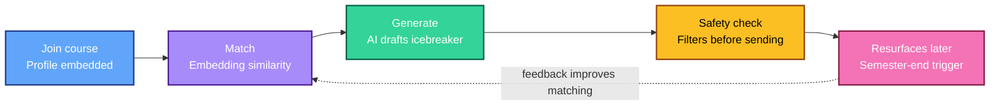
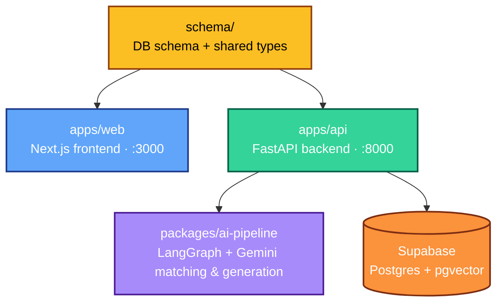

# Huskies Reconnect 🐾

**The classmate network that doesn't disappear when the semester does.**

Canvas shows you exactly who's in your class. The moment the course ends, that connection disappears. Huskies Reconnect fixes that — AI-matched classmate connections that persist past the semester, and resurface later when they actually matter.


Built for **NU Launch Labs** · Fall 2026 · Targeting full build by early December

---

## A note from the lead

I'm leading this project, and here's the vision I want us building toward:

> Every semester, you lose touch with dozens of people you shared a real experience with — not because the connection wasn't worth keeping, but because nothing ever turned it into something real. Huskies Reconnect should feel like the thing that *should have always existed* — not another directory, not another app you forget about. Something genuinely smart, genuinely useful, and something every one of us would be proud to put our name on.

I want this repo to be clear enough that anyone on the team can open it, understand exactly what we're building and why, and start contributing without needing to ask me what to do first. If a task on the board isn't claimed, I'll pick it up myself — nothing should sit stalled. Thoughts, pushback, and better ideas are always welcome; just raise them in the channel or as a GitHub Issue.

— Poornima, Founder & Lead

---

## How it works



| Who | What they get | How it works |
|---|---|---|
| **Student (in-course)** | Suggested classmates worth connecting with, plus a drafted icebreaker | Profile embeddings matched via similarity search; AI only generates a message for pairs that clear the relevance bar |
| **Student (post-course)** | The same classmate group, reactivated later | A semester-end trigger converts the course group into a persistent "alumni of this class" space |
| **Everyone** | Messages that are never inappropriate or spammy | Every AI-drafted message passes a safety/moderation check before it's ever shown |

Full architecture notes: [`docs/architecture.md`](docs/architecture.md)

---

## Repository map



| Path | What it is |
|---|---|
| `apps/web/` | Next.js + TypeScript + Tailwind frontend |
| `apps/api/` | FastAPI backend — auth, course join, matching endpoints |
| `packages/ai-pipeline/` | LangGraph pipeline: ingest → match → generate → safety → resurface |
| `schema/` | Database schema (Postgres + pgvector), shared types |
| `docs/` | Architecture notes, setup guides |

---

## Tech stack

- **Frontend:** Next.js, TypeScript, Tailwind CSS
- **Backend:** FastAPI (Python)
- **Database:** PostgreSQL + pgvector (Supabase)
- **AI / Agentic layer:** LangGraph, Google Gemini API
- **Observability:** LangSmith
- **Deployment:** Vercel (frontend), Render (backend)

---

## Getting started

```bash
# Clone the repo
git clone https://github.com/huskies-reconnect-org/huskies-reconnect.git
cd huskies-reconnect

# Frontend
cd apps/web
npm install
npm run dev        # http://localhost:3000

# Backend (separate terminal)
cd apps/api
pip install -r requirements.txt
uvicorn main:app --reload   # http://localhost:8000
```

Environment variables (`.env`, never commit this) will be shared separately in Teams — covers Supabase connection string and Gemini API key.

---

## How to contribute

1. Check [`TASKS.md`](TASKS.md) for the current phase's open tasks
2. Claim a task by adding your name, then open a matching GitHub Issue
3. Branch naming: `phase-1/your-task-name`
4. Open a PR into `main` when ready — tag me for review
5. Move your task across the [Project board](../../projects) as you go

No task is anyone's permanently — if something stalls, speak up in the channel and we'll reassign.

---

## Status

🚧 **Phase 1 — Foundation** in progress. See [`TASKS.md`](TASKS.md) for the full breakdown by phase.
