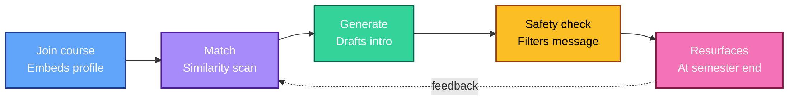
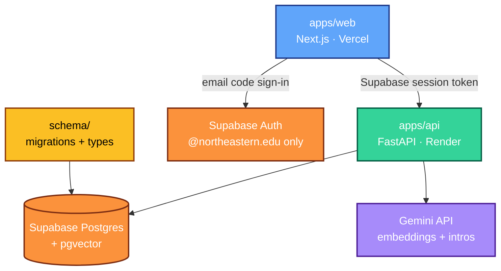

# Huskies Reconnect 🐾

**The classmate network that doesn't disappear when the semester does.**

Canvas shows you exactly who's in your class. The moment the course ends, that connection disappears. Huskies Reconnect fixes that — AI-matched classmate connections that persist past the semester, and resurface later when they actually matter.


Built for **NU Launch Labs** · Fall 2026 · Targeting full build by early December

---

## A note from the lead

I'm leading this project, and here's the vision I want us building toward:

> Every semester, you lose touch with dozens of people you shared a real experience with — not because the connection wasn't worth keeping, but because nothing ever turned it into something real. Huskies Reconnect should feel like the thing that *should have always existed* — not another directory, not another app you forget about. Something genuinely smart, genuinely useful, and something every one of us would be proud to put our name on.

I want this repo to be clear enough that anyone on the team can open it, understand exactly what we're building and why, and start contributing without needing to ask me what to do first. If a task on the board isn't claimed, I'll pick it up myself — nothing should sit stalled. Thoughts, pushback, and better ideas are always welcome; just raise them in the channel or as a GitHub Issue.

— Poornima, Founder & Lead

---

## How it works



| Who | What they get | How it works |
|---|---|---|
| **Student (in-course)** | Suggested classmates worth connecting with, plus a drafted icebreaker | Profile embeddings matched via similarity search; AI only generates a message for pairs that clear the relevance bar |
| **Student (post-course)** | The same classmate group, reactivated later | A semester-end trigger converts the course group into a persistent "alumni of this class" space |
| **Everyone** | Messages that are never inappropriate or spammy | Every AI-drafted message passes a safety/moderation check before it's ever shown |

---

## Repository map



| Path | What it is |
|---|---|
| `apps/web/` | Next.js + TypeScript + Tailwind: sign-in, courses, profile, matches, icebreakers |
| `apps/api/` | FastAPI: token verification, courses, profiles + embeddings, matching, icebreakers, safety checks |
| `schema/` | Supabase migrations (Postgres + pgvector, row-level security) and generated TypeScript types |
| `.github/workflows/` | CI: API tests on Postgres 17 + pgvector, web lint / type-check / build |

---

## How the pieces work

- **Sign-in:** a 6-digit email code (not a magic link, because Outlook's link scanner uses those up). A Supabase signup hook rejects anything but `@northeastern.edu`.
- **Matching:** your major, interests and goals are embedded with Gemini (`gemini-embedding-2`, 768 dims) and stored in pgvector. Classmates in the same course are ranked by cosine similarity, and only those above a relevance bar show up.
- **Icebreakers:** Gemini (`gemini-3.5-flash-lite`) drafts a short intro for a matched pair. Before it's shown it passes three layers: Gemini's safety filters, profile text passed as data (not instructions) to resist prompt injection, and our own check that rejects links, contact details, profanity and placeholder text.
- **After the semester:** the course becomes an alumni group. Former classmates still see each other, and intros switch to a "reconnecting" tone.

---

## Tech stack

- **Frontend:** Next.js, TypeScript, Tailwind CSS (Vercel)
- **Backend:** FastAPI, psycopg 3 (Render)
- **Database / auth:** Supabase (Postgres + pgvector, Auth with email codes)
- **AI:** Google Gemini API (embeddings and text generation)
- **CI:** GitHub Actions

---

## Running it locally

```bash
git clone https://github.com/huskies-reconnect-org/huskies-reconnect.git
cd huskies-reconnect

# Backend (Python 3.12)
cd apps/api
python3.12 -m venv .venv && source .venv/bin/activate
pip install -r requirements-dev.txt
cp ../../.env.example .env          # fill in the API section
uvicorn app.main:app --reload       # http://localhost:8000

# Frontend (separate terminal)
cd apps/web
npm install
cp ../../.env.example .env.local    # fill in the NEXT_PUBLIC_* values
npm run dev                         # http://localhost:3000
```

More detail: [`apps/api/README.md`](apps/api/README.md) (endpoints, tests, demo data), [`apps/web/README.md`](apps/web/README.md), [`schema/README.md`](schema/README.md) (migrations).

---

## Status

🚧 Building toward the **Dec 5, 2026** NU Launch Labs showcase. Plan: [`TASKS.md`](TASKS.md) · Log: [`PROGRESS.md`](PROGRESS.md)

Ideas and pushback are welcome as GitHub Issues.
